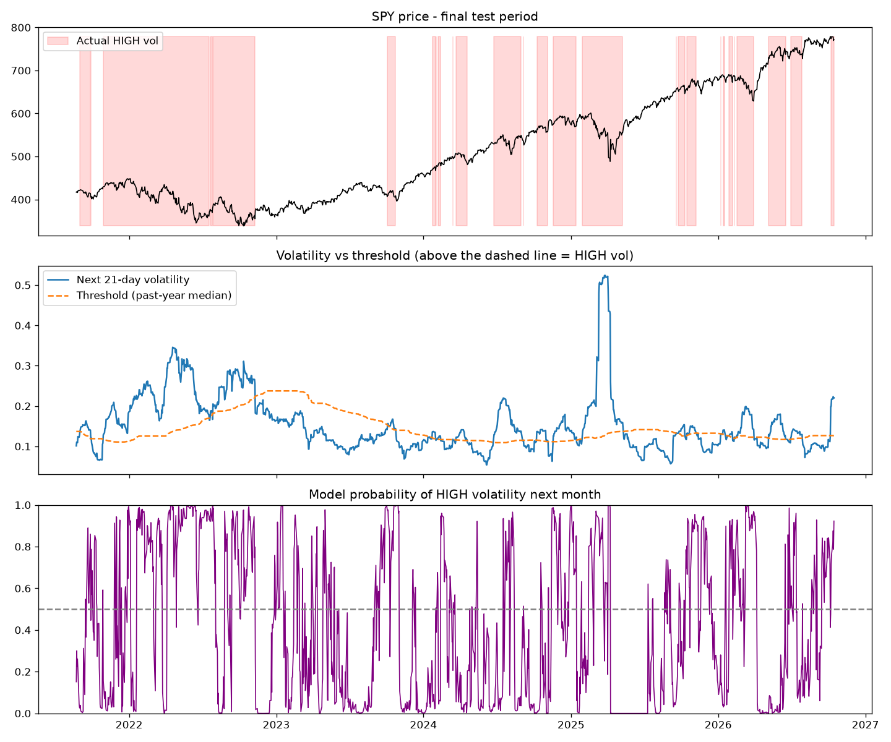
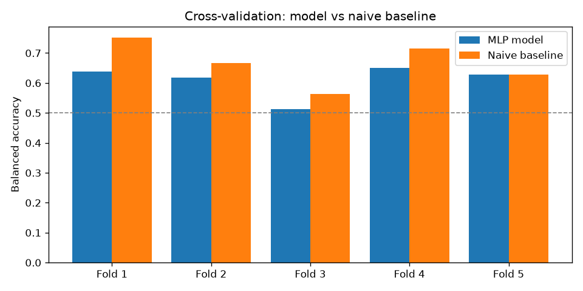

# SPY Volatility Regime Classifier

Predicts whether the next month (21 trading days) of SPY will be high or low volatility, using a small neural net (scikit-learn `MLPClassifier`).



## What it does

- Pulls daily SPY and VIX data from 2000 onward with `yfinance`
- Builds 22 features: realized vol over different windows, downside vol, high-low range vol, skew, kurtosis, drawdown, volume spikes, and VIX level/change
- Labels each day as high vol if the next 21 days end up more volatile than the past year's median
- Trains a `StandardScaler` + `MLPClassifier` pipeline
- Tests it with time-series cross-validation (5 periods) and a final test on the last ~5 years

I went with volatility instead of price since price direction is basically a coin flip. Volatility tends to cluster, so it's a bit more predictable.

## No data leakage

- Features only use data up to that day
- The vol threshold only uses the past year
- The scaler is inside the pipeline, so it only sees training data
- No shuffling: it always trains on older data and tests on newer data
- 21-day gap between train and test, since the labels look 21 days ahead

## Results

Compared against a simple rule: "next month = this month."

| | Model | Simple rule |
|---|---|---|
| Final test (2021–2026) | 64.3% | 64.9% |
| Avg across 5 periods | 60.9% | 66.5% |

*Balanced accuracy, 50% = coin flip.*

Basically a tie on recent data, and the simple rule still wins overall. Volatility is sticky, so "same as now" is hard to beat, especially in long stretches like 2008 or the super calm 2014–2018 run.

The model's better at calling calm months (73%) than stormy ones (56%), so it's not something I'd use as a warning system. Adding the VIX helped the most.



## Run it

```bash
python -m venv venv
venv\Scripts\activate          # Mac/Linux: source venv/bin/activate
pip install -r requirements.txt
python regime_classifier.py
```

Close the chart windows when they pop up and it'll keep going. It prints a quick summary at the end with next month's outlook.

Run it after market close, otherwise today's unfinished day makes the numbers move around.

## Next

- Tune the decision threshold to catch more stormy periods
- Try gradient boosting
- Plug the predicted regime into my [JPM Monte Carlo] sim instead of using a fixed volatility

*Not investment advice.*